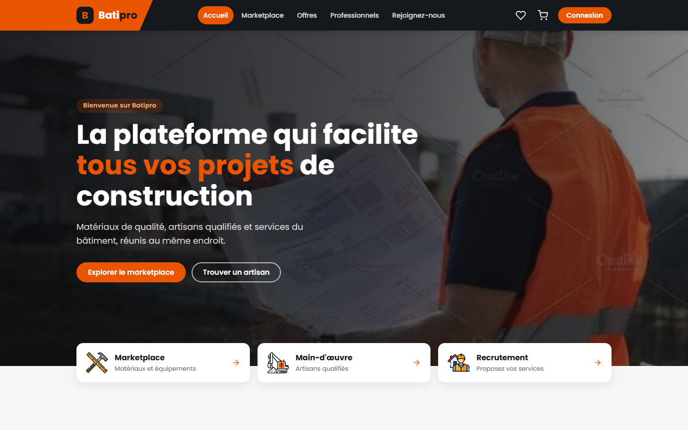
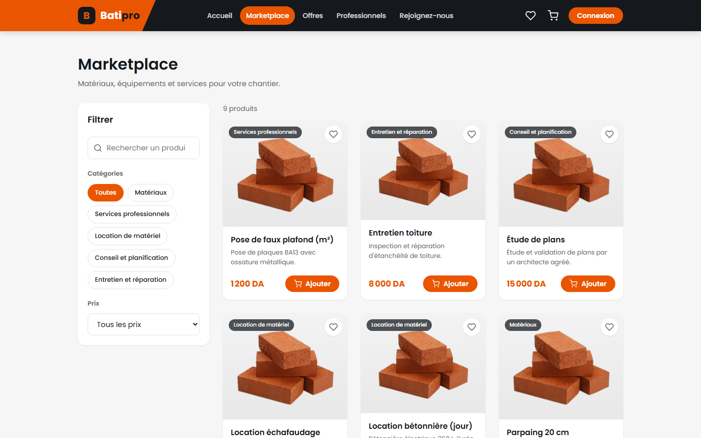

# Batipro

🔗 **Démo en ligne : https://batipro-web.onrender.com**
(hébergement gratuit : la première ouverture peut prendre environ 30 secondes)


| Accueil | Marketplace |
|---|---|
|  |  |

Batipro est une plateforme web dédiée au secteur du bâtiment en Algérie. Elle réunit au même endroit
les matériaux de construction, les artisans qualifiés et les services pour réaliser ses projets.

## Fonctionnalités

### Pour les clients
- Créer un compte et se connecter
- Parcourir le marketplace et filtrer les produits par catégorie, prix ou mot-clé
- Ajouter des produits aux favoris
- Gérer son panier et passer commande (avec ou sans livraison)
- Découvrir les offres et accéder aux produits correspondants
- Rechercher un professionnel par nom, localisation ou métier
- Consulter le profil d'un professionnel, ses avis et sa note
- Laisser un avis et une note sur un professionnel
- Envoyer une demande d'embauche à un professionnel
- Discuter en direct avec les professionnels grâce à la messagerie en ligne
- Suivre ses commandes et ses demandes d'embauche dans « Mon compte »

### Pour les professionnels (Espace pro)
- Proposer ses services via le formulaire de recrutement
- Suivre l'état de sa candidature et apparaître dans la liste après validation
- Recevoir les demandes d'embauche et les accepter ou les refuser
- Modifier sa fiche publique (métiers, ville, présentation, expérience)
- Consulter ses avis et sa note
- Échanger avec les clients par messagerie

### Pour les vendeurs (Espace vendeur)
- Ajouter, modifier et supprimer ses produits, gérer son stock
- Voir les commandes qui contiennent ses produits
- Suivre son chiffre d'affaires et ses produits en rupture

### Pour l'administrateur
- Tableau de bord avec les chiffres clés
- Valider ou refuser les demandes de recrutement
- Consulter les profils des professionnels et des vendeurs
- Ajouter, modifier et supprimer des produits
- Gérer les offres affichées sur le site
- Suivre, valider ou annuler les commandes
- Répondre aux messages

### Messagerie en ligne
- Conversations en temps réel
- Indicateur « en ligne » et « écrit… »
- Messages lus / non lus et compteur de non-lus

### Site responsive
- Utilisable sur téléphone, tablette et ordinateur

## Stack technique

| Couche | Technologies |
|---|---|
| Front | React (Create React App), React Router, Axios, Socket.IO client |
| API | Node.js, Express, Multer (upload d'images), Socket.IO |
| Base de données | SQLite (module natif `node:sqlite`), données de démo générées au démarrage |
| Déploiement | Render (Blueprint `render.yaml` : API Node + site statique) |

## Lancer en local

Prérequis : Node.js 22.5 ou plus récent (pour `node:sqlite`).

```bash
# 1. API (http://127.0.0.1:8000)
cd backend
cp .env.example .env
npm install
npm run seed      # crée la base SQLite avec les données de démo
npm run dev

# 2. Front (http://localhost:3000), dans un second terminal
cd frontend
cp .env.example .env
npm install
npm start
```

L'architecture détaillée (routes, schéma de base, messagerie temps réel) est décrite dans
[`docs/TECHNIQUE.md`](docs/TECHNIQUE.md).
